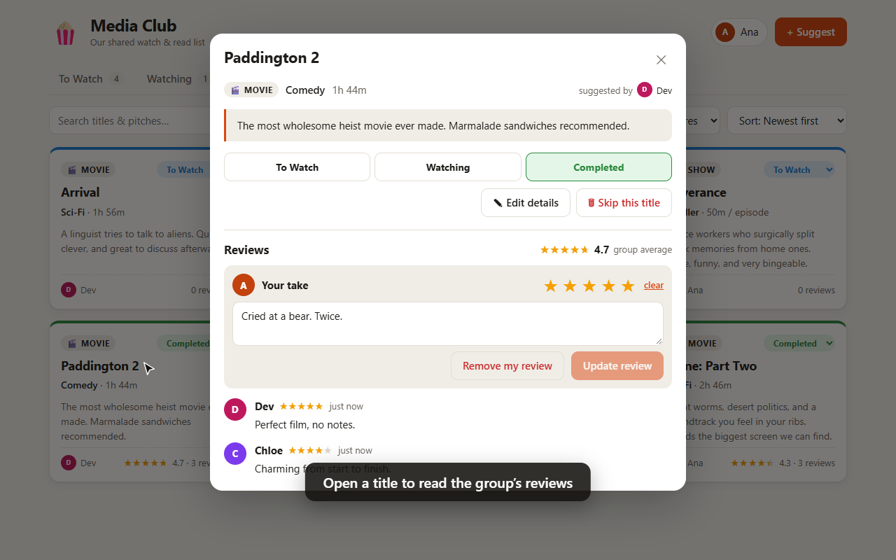
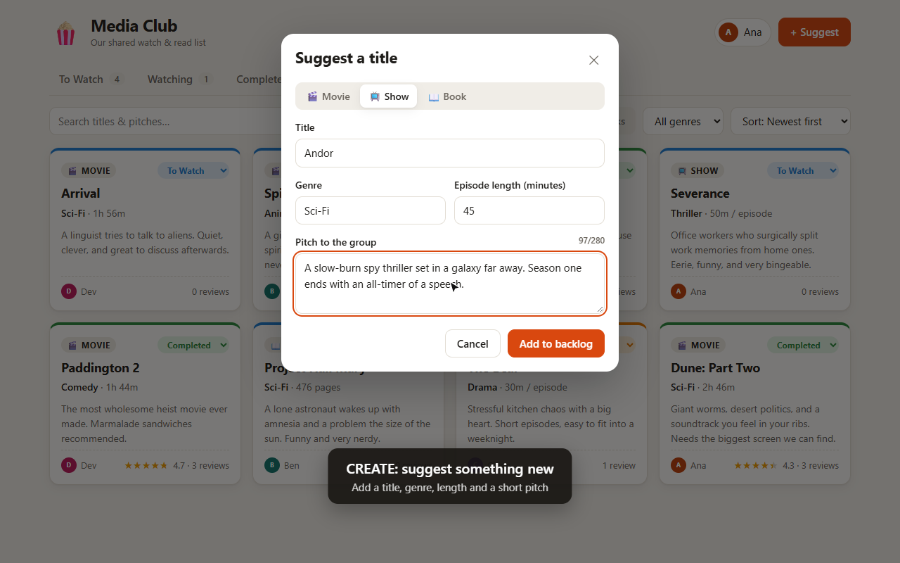
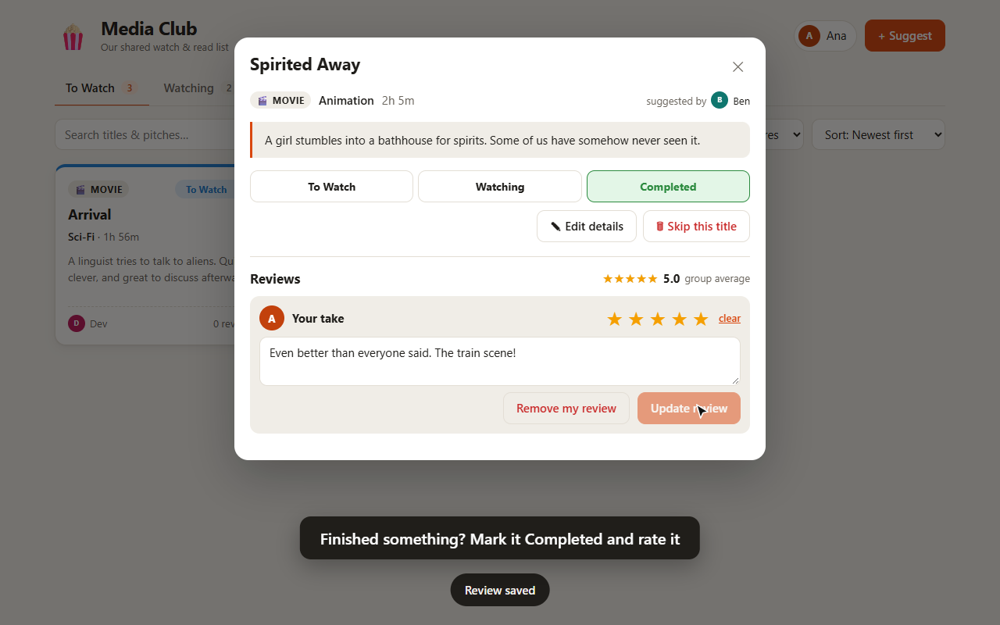

# 🍿 Media Club: Group Watchlist

A small CRUD app for a circle of friends. Members suggest movies, shows and books to a shared backlog, move them from **To Watch → Watching → Completed**, and leave star ratings and comments.

## Demo

▶️ **[Watch the walkthrough video](demo/media-club-demo.webm)** (about 1½ minutes). It covers picking a member, browsing, filtering and sorting, suggesting a title, moving its status, rating and reviewing, editing, and skipping a title.

| Browse & review                             | Suggest a title                                       | Rate it                                                 |
| ------------------------------------------- | ----------------------------------------------------- | ------------------------------------------------------- |
|  |  |  |

To record the demo again, run `npm run demo`. It uses a throwaway database and your installed Chrome or Edge. On first use, Playwright asks you to run `npx playwright-core install ffmpeg`.

## Quick start

Requires **Node 22.13+**. The app uses the built-in `node:sqlite` module, so there are no native modules to compile.

```bash
npm install
npm run dev
```

Open http://localhost:5173. The API runs on http://localhost:3001; Vite forwards `/api` requests to it.

On first run the database (`server/data/club.db`) is created and filled with four members and eight sample titles. To start over, stop the app and delete `server/data/`.

| Command                              | What it does                                                              |
| ------------------------------------ | ------------------------------------------------------------------------- |
| `npm run dev`                        | Starts the API and web client with hot reload                             |
| `npm test`                           | Runs the API tests (Node's built-in test runner, in-memory DB)            |
| `npm run typecheck`                  | Type-checks server and client                                             |
| `npm run lint`                       | ESLint (type-aware, with React hooks rules)                               |
| `npm run format` / `format:check`    | Formats with Prettier / checks formatting                                 |
| `npm run check`                      | Typecheck, lint, format check and tests: what CI runs                     |
| `npm start`                          | Builds the client and serves the app and API from one server on port 3001 |
| `npm run demo`                       | Records the walkthrough video and screenshots into `demo/`                |
| `npm run release-member -- "<name>"` | Frees a member's profile so they can claim it again (e.g. lost device)    |

Environment variables: `API_PORT` (default `3001`), `DB_FILE` (default `server/data/club.db`) and `HOST` (default `127.0.0.1`, so the API is only reachable from this computer; set `HOST=0.0.0.0` to share it on your network).

CI (`.github/workflows/ci.yml`) runs typecheck, lint, format check, tests and build on every push to `main` and every pull request.

## Features

|            |                                                                                                                                                                                          |
| ---------- | ---------------------------------------------------------------------------------------------------------------------------------------------------------------------------------------- |
| **Create** | Suggest a movie, show or book with genre, length and a short pitch (up to 280 characters). New members can join from the "Who's watching?" dialog.                                       |
| **Read**   | Status tabs with counts; filter by type, genre or a search term; sort by newest, oldest, title, genre, runtime or rating. Open a title to read the full pitch and every member's review. |
| **Update** | Change status from the card dropdown or the detail view; edit a title's details; add or update your own 1–5 star rating and comment.                                                     |
| **Delete** | "Skip this title" (with a confirmation) removes it and its reviews. You can also remove your own review.                                                                                 |

### Who you are

There are no passwords. When you join, or pick a name nobody has claimed yet, the server gives this browser a private key, and every change you make is checked against it:

- You can only add, edit or delete **your own** review, and new suggestions are credited to you by the server.
- Browsing is open to anyone; suggesting, changing status, editing and skipping need a member.
- A profile can be held by one key at a time. To use the same profile on another device, open **your name → sign-in link** and open that link there. Anyone with the link can post as you, so keep it private.
- "Not you? Give this profile back" releases it so it can be claimed again. If someone loses their only device, run `npm run release-member -- "<name>"`.

## Architecture

```
server/            Express 5 + TypeScript + SQLite (node:sqlite) + Zod
  src/db.ts        schema, migrations, first-run seed data
  src/app.ts       REST routes, identity checks, validation, error handling
  src/auth.ts      per-device keys (only their SHA-256 hash is stored)
  src/index.ts     starts the API (and serves client/dist in production)
  test/            API tests
client/            React 19 + TypeScript + Vite, plain CSS (light/dark)
  src/App.tsx      queue page wiring
  src/hooks/       useIdentity (members + current member), useToast
  src/components/  ItemCard, ItemDetailModal, ItemForm, MemberPicker, FilterToolbar, ui
```

### Data model

- **members**: `id, name (unique), color, token_hash` (the hash of the device key; never returned by the API)
- **items**: `id, title, type (movie|show|book), genre, runtime, pitch, status (to_watch|watching|completed), suggested_by → members`
- **reviews**: `id, item_id → items (cascade delete), member_id → members, stars (1–5, optional), comment`. Each member has at most one review per title.

`runtime` is in minutes for movies, minutes per episode for shows, and pages for books. Runtime sorting therefore groups items by type first.

### API

| Method                                    | Path | Notes |
| ----------------------------------------- | ---- | ----- |
| 🔒 = needs `Authorization: Bearer <key>`. |

| Method | Path                                  | Notes                                                                                                     |
| ------ | ------------------------------------- | --------------------------------------------------------------------------------------------------------- |
| GET    | `/api/members`                        | `{ id, name, color, claimed }[]`                                                                          |
| POST   | `/api/members`                        | Join: `{ name }` → `{ member, token }`                                                                    |
| POST   | `/api/members/:id/claim`              | Claim an unclaimed profile → `{ member, token }`; 409 if already claimed                                  |
| GET    | `/api/me` 🔒                          | The current member                                                                                        |
| POST   | `/api/me/release` 🔒                  | Give the profile back                                                                                     |
| GET    | `/api/genres`                         | Distinct genres                                                                                           |
| GET    | `/api/items`                          | Query: `status, type, genre, q, sort` (`newest, oldest, title, genre, runtime_asc, runtime_desc, rating`) |
| GET    | `/api/items/:id`                      | Includes `reviews[]`                                                                                      |
| POST   | `/api/items` 🔒                       | `{ title, type, genre, runtime?, pitch? }`; `suggested_by` is set to the caller                           |
| PATCH  | `/api/items/:id` 🔒                   | Any subset of `title, type, genre, runtime, pitch, status`                                                |
| DELETE | `/api/items/:id` 🔒                   | 204                                                                                                       |
| PUT    | `/api/items/:id/reviews/:memberId` 🔒 | `{ stars?, comment? }`; creates or updates the review. 403 unless `:memberId` is the caller               |
| DELETE | `/api/items/:id/reviews/:memberId` 🔒 | 403 unless `:memberId` is the caller                                                                      |

Errors come back as `{ "error": "message" }` with the matching status code: 400 for invalid input, 401 when you need to pick who you are, 403 for someone else's review, 404 when something isn't found, 409 for a duplicate name or an already-claimed profile.
